<p align="center">
  <picture>
    <source media="(prefers-color-scheme: dark)" srcset="docs/static/brand/logo-stacked.svg">
    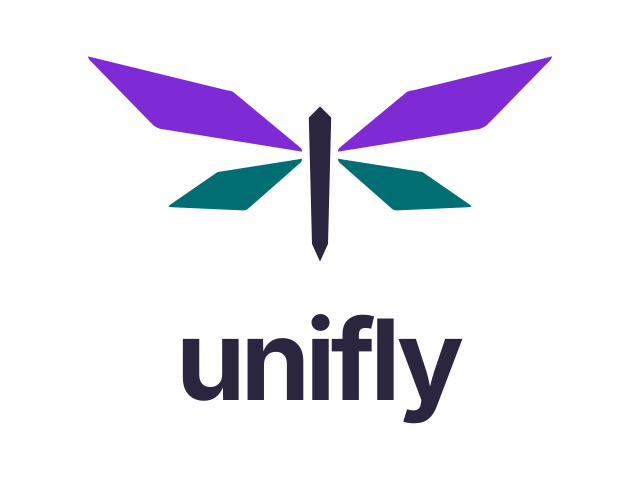
  </picture>
</p>

<p align="center">
  Your UniFi network, at your fingertips.<br>
  <sub>CLI + TUI for humans and agents</sub>
</p>

<p align="center">
  <a href="https://www.rust-lang.org">
    
  </a>
  <a href="https://doc.rust-lang.org/edition-guide/rust-2024/index.html">
    
  </a>
  <a href="https://ratatui.rs">
    
  </a>
  <a href="https://crates.io/crates/opaline">
    
  </a>
  <a href="https://tokio.rs">
    
  </a>
  <a href="LICENSE">
    
  </a>
  <a href="https://github.com/sponsors/hyperb1iss">
    
  </a>
</p>

<p align="center">
  <a href="#-features">Features</a> •
  <a href="#-install">Install</a> •
  <a href="#-quick-start">Quick Start</a> •
  <a href="#-cli">CLI</a> •
  <a href="#-tui">TUI</a> •
  <a href="#-architecture">Architecture</a> •
  <a href="#-library">Library</a> •
  <a href="#-ai-agent-skill">AI Agent Skill</a> •
  <a href="#-development">Development</a>
</p>

<p align="center">
  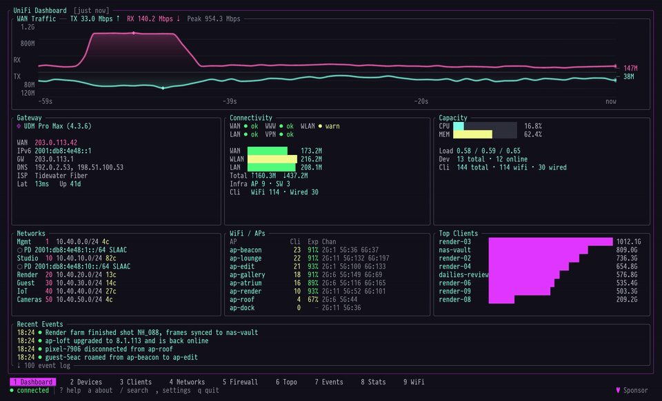
</p>

---

## 💜 What is unifly?

A complete command-line toolkit for managing Ubiquiti UniFi network controllers. One binary with 29 top-level commands for scripting and a built-in TUI dashboard for real-time monitoring, powered by a shared async engine that speaks every UniFi API dialect, including Site Manager cloud fleet APIs and the cloud connector.

> _Manage devices, monitor clients, inspect VLANs, stream events, and watch bandwidth charts, all without leaving your terminal._

UniFi controllers expose multiple APIs with different capabilities. unifly unifies them all into a single, coherent interface so you never have to think about which endpoint to hit.

---

> ### 🤖 AI Agent? 👤 Human? Both Welcome.
>
> unifly speaks fluent silicon _and_ carbon.
>
> **Coding agents** get a small [discovery skill](skills/unifly/SKILL.md) that loads version-matched guidance from `unifly skill`. The binary ships command discovery, automation workflows, and payload examples, all available offline. The [install scripts](#-install) add the skill to `~/.agents/skills` for you; after any other install method, one command does it:
>
> ```bash
> unifly skill --install           # --claude targets Claude Code's skills directory
> ```
>
> `npx skills add hyperb1iss/unifly` installs the same skill without the binary, but agents still need the binary to load the guide. Older binaries without `unifly skill` need an update before they can serve it.
>
> **Humans** get a gorgeous 11-screen TUI, shell completions, pipe-friendly output, and the quiet satisfaction of never opening the UniFi web UI again. Keep scrolling to [Install](#-install).

<p align="center">
  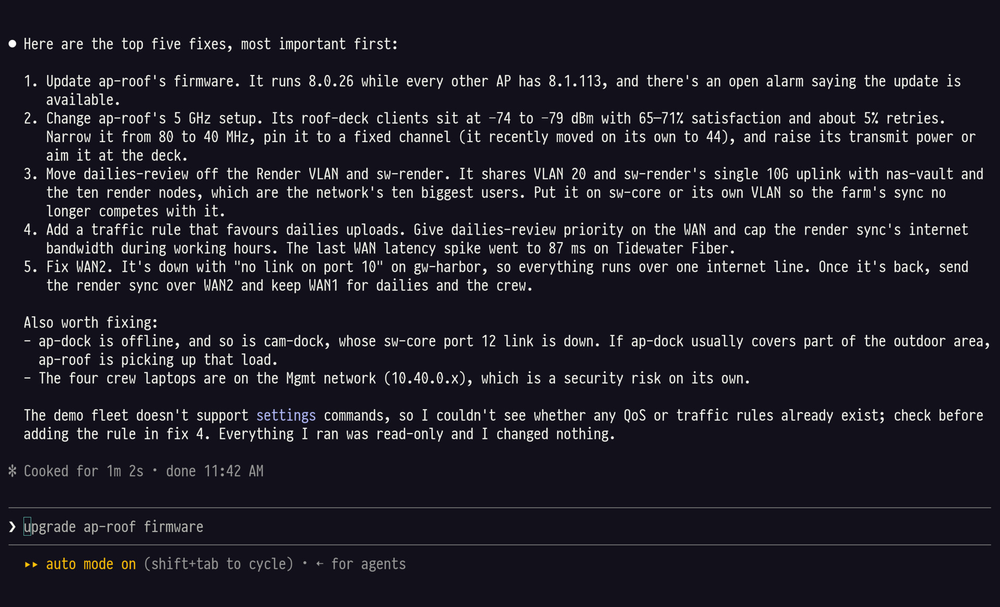
</p>

<p align="center">
  <sub>Claude Code loads the unifly skill, works the <code>--demo-fleet</code> studio network with read-only commands and <code>jq</code>, and comes back with a punch list.</sub>
</p>

---

## ✦ Features

| Capability                    | What You Get                                                                                                                                                                                                        |
| ----------------------------- | ------------------------------------------------------------------------------------------------------------------------------------------------------------------------------------------------------------------- |
| 🔮 **Triple-Path API Engine** | Integration API + Session API via a single API key on UniFi OS, plus Site Manager cloud fleet and connector support. Hybrid mode adds WebSocket for live event streaming                                            |
| ⚡ **Real-Time TUI**          | 11-screen dashboard with SilkCircuit octant traffic charts, CPU/MEM gauges, live client counts, zoomable topology, and auto-detected graphics-protocol charts (Kitty/Sixel/iTerm2)                                  |
| 🦋 **29 Top-Level Commands**  | Devices and switch port config-as-code, clients, networks, WiFi, firewall policies/zones/groups, ACLs, NAT, DNS, full VPN surface, DPI, RADIUS, site settings, topology, cloud fleet, raw API passthrough, `tui`... |
| 📡 **Wi-Fi Observability**    | Neighboring APs, regulatory channels, per-client Wi-Fi experience scores, roam timelines                                                                                                                            |
| 💎 **Flexible Output**        | Table, JSON, compact JSON, YAML, and plain text. Pipe-friendly for scripting                                                                                                                                        |
| 🔒 **Secure Credentials**     | OS keyring storage for API keys and passwords by default. Explicit `api_key` / `password` in TOML config wins when set, useful for headless or shared machines.                                                     |
| 🌐 **Multi-Profile**          | Named profiles for multiple controllers. Switch with a single flag                                                                                                                                                  |
| 🧠 **Smart Config**           | Interactive wizard, environment variables, TOML config, CLI overrides                                                                                                                                               |
| 📡 **WebSocket Events**       | Live event streaming with 10K rolling buffer, severity filtering, pause/scroll-back                                                                                                                                 |
| 📊 **Historical Stats**       | WAN bandwidth area fills, client counts, DPI app/category breakdown (1h to 30d)                                                                                                                                     |
| 🎨 **SilkCircuit Theme**      | Neon-on-dark color palette powered by [opaline](https://crates.io/crates/opaline). Token-based theming across CLI and TUI with ANSI fallback                                                                        |

---

## ⚡ Install

### Linux / macOS

```bash
curl -fsSL https://raw.githubusercontent.com/hyperb1iss/unifly/main/install.sh | sh
```

### Windows (PowerShell)

```powershell
irm https://raw.githubusercontent.com/hyperb1iss/unifly/main/install.ps1 | iex
```

### Other Methods

| Method       | Command                                                                               |
| ------------ | ------------------------------------------------------------------------------------- |
| **Homebrew** | `brew install hyperb1iss/tap/unifly`                                                  |
| **AUR**      | `yay -S unifly-bin`                                                                   |
| **Cargo**    | `cargo install unifly`                                                                |
| **Binary**   | Download from [GitHub Releases](https://github.com/hyperb1iss/unifly/releases/latest) |

The install scripts also add the [agent skill](#-ai-agent-skill) to `~/.agents/skills` for your user (set `UNIFLY_NO_SKILL=1` to skip). Homebrew and AUR install unifly for every user and cannot write into your home directory, so after those, Cargo, or a manual download, run `unifly skill --install` yourself.

---

## 🔮 Quick Start

Run the interactive setup wizard:

```bash
unifly config init            # Local controller
unifly config cloud-setup     # Site Manager / cloud controller
```

The local wizard walks you through controller URL, authentication method, and site selection, and asks whether the controller uses a self-signed certificate (defaulting yes for IPs and `.local`-style hostnames, no for public ones). The cloud wizard validates your Site Manager API key, lets you pick a console by name, discovers its sites, and writes a ready-to-use cloud profile. Credentials can be stored in your OS keyring, referenced from `UNIFI_API_KEY`, or saved in plaintext config, depending on the path you choose.

Once configured:

```bash
unifly devices list              # All adopted devices
unifly devices ports my-switch   # Live port states with connected clients
unifly clients list              # Connected clients
unifly networks list             # VLANs and subnets
unifly firewall groups list      # Port and address groups (Session API)
unifly vpn servers               # VPN server inventory
unifly settings list             # Site-level setting sections
unifly wifi neighbors            # Nearby APs your radios can see
unifly clients wifi 10.0.0.42    # Per-client Wi-Fi experience score
unifly events watch              # Live event feed (requires Hybrid auth)
unifly cloud hosts               # Consoles visible through Site Manager
unifly cloud switch default      # Re-target the active cloud profile to another site
```

```
 ID                                   | Name            | Model           | Status
--------------------------------------+-----------------+-----------------+--------
 a1b2c3d4-e5f6-7890-abcd-ef1234567890 | Office Gateway  | UDM-Pro         | ONLINE
 b2c3d4e5-f6a7-8901-bcde-f12345678901 | Living Room AP  | U6-LR           | ONLINE
 c3d4e5f6-a7b8-9012-cdef-123456789012 | Garage Switch   | USW-Lite-8-PoE  | ONLINE
```

Create commands print the created entity on stdout in the chosen `--output`
format, so scripts capture IDs directly:

```bash
NET_ID=$(unifly networks create --name lab --management switch --vlan 42 -o json | jq -r .id)
```

---

## 🔐 Authentication

### API Key (recommended)

Generate a key on your controller under **Settings > Integrations**. On UniFi
OS controllers, the same key also authenticates session HTTP endpoints, so API
key mode covers most CLI automation: CRUD, device commands, stats, DHCP
reservations, admin operations, Wi-Fi observability (`wifi neighbors`,
`wifi channels`, `clients roams`, `clients wifi`), and `events list`.

```bash
unifly config init                     # Select "API Key" during setup
unifly --api-key <KEY> devices list    # Or pass directly
```

Live WebSocket features still need a session cookie, so `events watch`
requires **Username/Password** or **Hybrid**.

### Username / Password

Session-based auth with cookie and CSRF token handling. Use this when
you need live WebSocket features (`events watch`) or when your controller does
not accept API keys on session HTTP endpoints.

```bash
unifly config init                     # Select "Username/Password" during setup
```

### Hybrid Mode

Best of both worlds: API key for Integration API plus session HTTP, and
username/password for the WebSocket cookie session. Choose this when you want
full live monitoring plus maximum compatibility.

### Cloud / Site Manager

Use `auth_mode = "cloud"` when the controller is only reachable through
Site Manager. unifly will route Integration-backed commands through the cloud
connector and can auto-resolve `host_id` when exactly one console, or one
owner console, is visible to the API key.

```bash
unifly config cloud-setup
unifly cloud hosts
unifly cloud sites
unifly cloud switch default
unifly --profile cloud-home networks list
```

If the API key can see more than one console, `unifly cloud ...` still works
without `host_id`, but controller-bound commands such as `devices list` need a
saved `host_id` or a unique auto-resolution path. `unifly cloud switch <site>`
updates the active cloud profile's controller-side site target using the
connector's site names or internal references.

### Environment Variables

| Variable         | Description                                                |
| ---------------- | ---------------------------------------------------------- |
| `UNIFI_API_KEY`  | Integration API key                                        |
| `UNIFI_USERNAME` | Session auth username                                      |
| `UNIFI_PASSWORD` | Session auth password                                      |
| `UNIFI_HOST_ID`  | Site Manager console/host ID for cloud connector mode      |
| `UNIFI_URL`      | Controller URL                                             |
| `UNIFI_PROFILE`  | Profile name                                               |
| `UNIFI_SITE`     | Site name or UUID                                          |
| `UNIFI_OUTPUT`   | Default output format                                      |
| `UNIFI_INSECURE` | Accept self-signed TLS certs (`false` forces verification) |
| `UNIFI_TIMEOUT`  | Request timeout (seconds)                                  |
| `UNIFI_TOTP`     | TOTP code for MFA-enabled controllers                      |
| `UNIFI_DEMO`     | Sanitize PII for demo recordings                           |

Flags and environment variables override profile values, profiles override
the `[defaults]` config section, and `[defaults]` overrides the built-in
fallbacks (30-second timeout, system TLS verification). One exception:
`UNIFI_USERNAME` and `UNIFI_PASSWORD` fill in only when the profile does
not set its own `username`/`password`, so a profile's configured session
credentials win over the environment.

---

## 💻 CLI

Tables for people, JSON and plain IDs for scripts, and names that resolve wherever an ID would go:

<p align="center">
  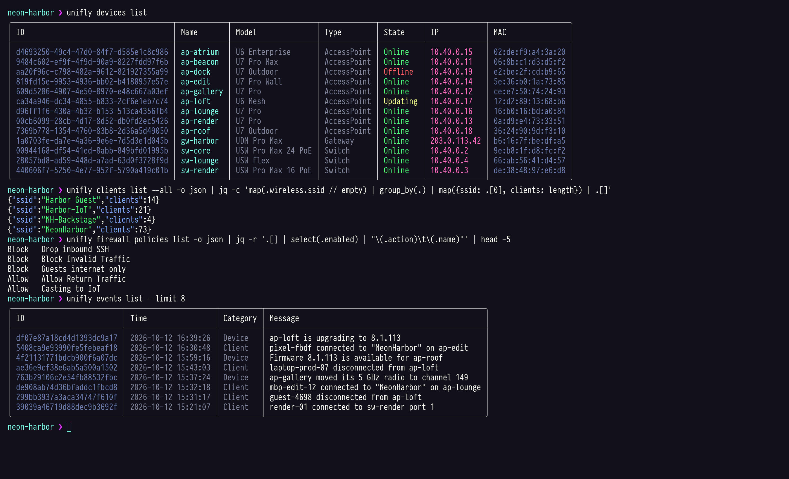
</p>

### Commands

| Command         | Alias      | Description                                                                                                                                                                  |
| --------------- | ---------- | ---------------------------------------------------------------------------------------------------------------------------------------------------------------------------- |
| `acl`           |            | Manage ACL rules                                                                                                                                                             |
| `admin`         |            | Administrator management                                                                                                                                                     |
| `alarms`        |            | Manage alarms                                                                                                                                                                |
| `clients`       | `cl`       | Manage clients and DHCP reservations                                                                                                                                         |
| `cloud`         |            | Query Site Manager hosts, sites, devices, ISP metrics, SD-WAN, and switch the active cloud site                                                                              |
| `completions`   |            | Generate shell completions                                                                                                                                                   |
| `config`        |            | Manage CLI configuration                                                                                                                                                     |
| `countries`     |            | List available country codes                                                                                                                                                 |
| `devices`       | `dev`, `d` | Manage adopted and pending devices, plus switch port config-as-code (`ports`, `ports-export`, `port-set`)                                                                    |
| `dns`           |            | Manage DNS policies (local records)                                                                                                                                          |
| `dpi`           |            | DPI reference data                                                                                                                                                           |
| `events`        |            | View and stream events                                                                                                                                                       |
| `firewall`      | `fw`       | Manage firewall policies, zones, and groups (port / address / ipv6-address)                                                                                                  |
| `nat`           |            | Manage NAT policies (masquerade, SNAT, DNAT)                                                                                                                                 |
| `hotspot`       |            | Manage hotspot vouchers                                                                                                                                                      |
| `networks`      | `net`, `n` | Manage networks and VLANs                                                                                                                                                    |
| `radius`        |            | View RADIUS profiles                                                                                                                                                         |
| `settings`      |            | View and modify site-level settings (Session API)                                                                                                                            |
| `sites`         |            | Manage sites                                                                                                                                                                 |
| `stats`         |            | Query statistics and reports                                                                                                                                                 |
| `system`        | `sys`      | System operations and info                                                                                                                                                   |
| `topology`      | `topo`     | Show network topology tree                                                                                                                                                   |
| `traffic-lists` |            | Manage traffic matching lists                                                                                                                                                |
| `vpn`           |            | View VPN inventory, session site-to-site, remote-access, and client records, OpenVPN helpers, VPN connections, WireGuard peers, magic site-to-site configs, and VPN settings |
| `wans`          |            | View WAN interfaces                                                                                                                                                          |
| `wifi`          | `w`        | Manage WiFi broadcasts (SSIDs)                                                                                                                                               |
| `api`           |            | Raw API passthrough (GET/POST/PUT/PATCH/DELETE to any endpoint)                                                                                                              |
| `tui`           |            | Launch the real-time terminal dashboard                                                                                                                                      |

Most resource groups support `list` and `get`; some also expose `create`, `update`, `delete`, `patch`, or specialized actions. Run `unifly <command> --help` for details.

Cloud note: `unifly cloud ...` talks directly to Site Manager and does not
require a controller connection. Session-only commands such as `events watch`
still need direct Session API access.

### Global Flags

```
-p, --profile <NAME>     Controller profile to use
-c, --controller <URL>   Controller URL (overrides profile)
-s, --site <SITE>        Site name or UUID
    --api-key <KEY>      Integration API key
-o, --output <FORMAT>    Output: table, json, json-compact, yaml, plain
-k, --insecure[=BOOL]    Accept self-signed TLS certs (--insecure=false forces verification)
    --no-cache           Disable session caching (forces fresh login)
-v, --verbose            Increase verbosity (-v, -vv, -vvv)
-q, --quiet              Suppress non-error output
-y, --yes                Skip confirmation prompts
    --timeout <SECS>     Request timeout in seconds (default 30, profiles may override)
    --color <MODE>       Color: auto, always, never
```

### Shell Completions

```bash
# Bash
unifly completions bash > ~/.local/share/bash-completion/completions/unifly

# Zsh
unifly completions zsh > ~/.zfunc/_unifly

# Fish
unifly completions fish > ~/.config/fish/completions/unifly.fish

# PowerShell
unifly completions powershell | Out-String | Invoke-Expression
```

---

## 🖥️ TUI

`unifly tui` launches an 11-screen real-time dashboard for monitoring and managing your network.

```bash
unifly tui                   # Launch with default profile
unifly tui -p office         # Use a specific profile
unifly tui -k                # Accept self-signed TLS certs
unifly tui --demo-fleet      # Explore a synthetic studio network, no controller needed
```

`--demo-fleet` (or `UNIFI_DEMO_FLEET=1`) runs the CLI and TUI against Neon Harbor Studios, an offline simulated network with 13 devices, about 140 clients, six VLANs, and live traffic, events, and a few problems to find. It never reads your config or keyring, which makes it a safe sandbox for trying the TUI or pointing an agent at unifly.

Cloud profiles can launch the TUI for a single connector-backed console. Fleet
aggregation, Site Manager host switching, and Session-only live features are
still outside the TUI surface today.

<p align="center">
  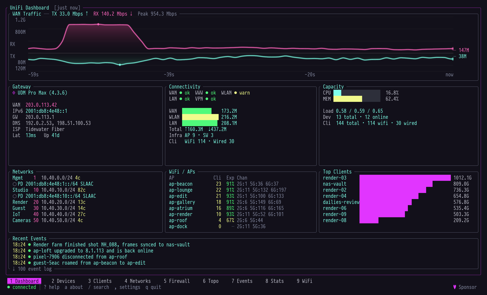
</p>

| Screen         | Highlights                                                                                       |
| -------------- | ------------------------------------------------------------------------------------------------ |
| **Dashboard**  | btop-style overview: mirrored RX/TX WAN chart, gateway info, CPU/MEM gauges, top clients, events |
| **Devices**    | Model, firmware with update markers, clients, CPU/MEM. Detail panel with a switch port map       |
| **Clients**    | Network, uplink AP or switch port, signal, traffic. Filter by type. Block/unblock/kick           |
| **Networks**   | VLAN topology with inline edit overlay for live config changes                                   |
| **Firewall**   | Policies grouped by zone pair in evaluation order, plus zones, ACL, and NAT                      |
| **Topology**   | Zoomable network tree with pan, zoom, fit-to-view                                                |
| **Events**     | Live stream with an events-by-hour heatmap, 10K buffer, pause, and search                        |
| **Stats**      | WAN bandwidth, client counts, DPI breakdown (1h/24h/7d/30d)                                      |
| **WiFi**       | AP health across 2.4/5/6 GHz, per-client experience, neighboring APs, and roaming history        |
| **Settings**   | Profile switching, theme selector, display preferences                                           |
| **Onboarding** | First-run setup wizard                                                                           |

### ✦ Gallery

Every capture below is the built-in `--demo-fleet` network at 183x47 in Ghostty.

**Devices**: model, firmware with update markers, client counts, and live CPU/MEM, plus the switch port map in the detail panel

<p align="center">
  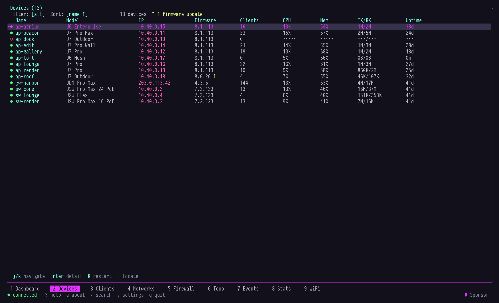
  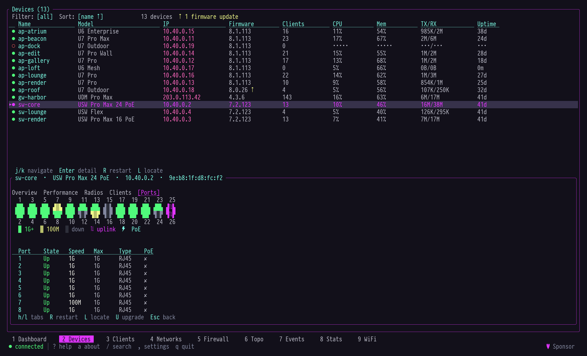
</p>

**Clients and Networks**: every client with its network and uplink, and each VLAN with its gateway, subnet, and IPv6 mode

<p align="center">
  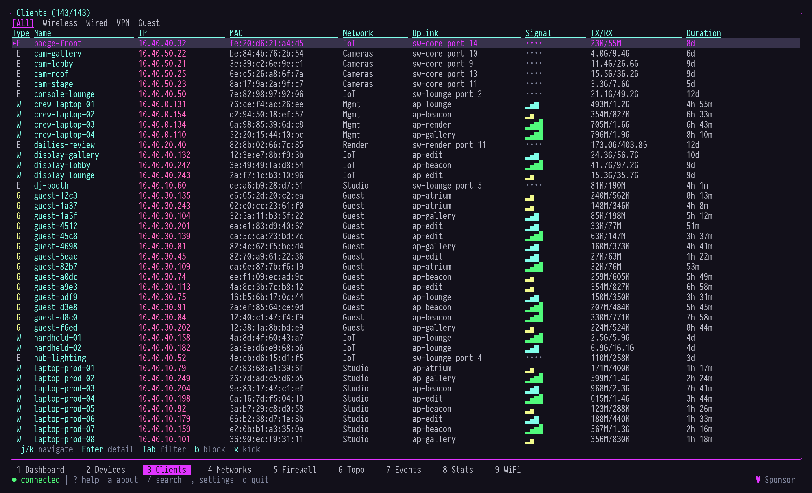
  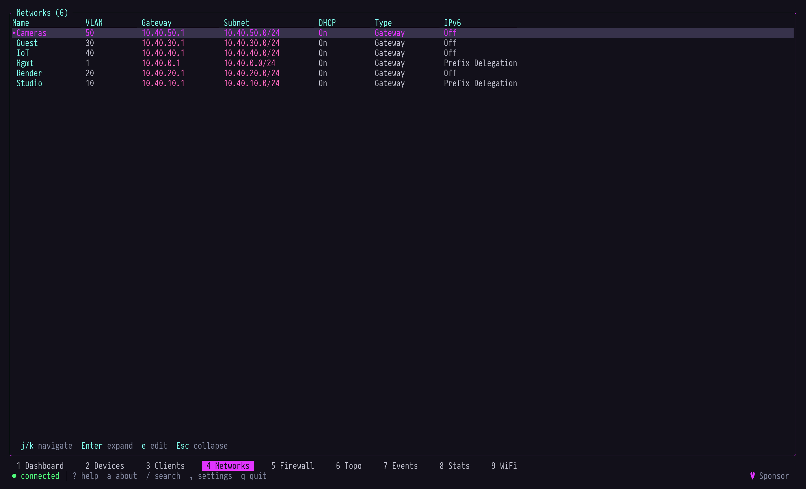
</p>

**Wi-Fi observability**: AP health across every band, per-client experience, and the neighbors your APs can hear

<p align="center">
  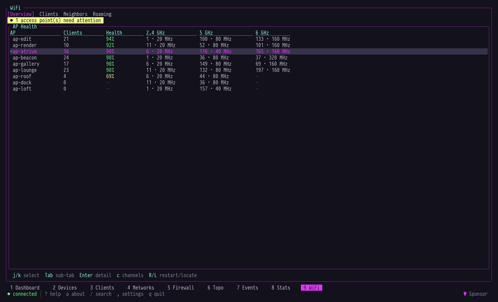
  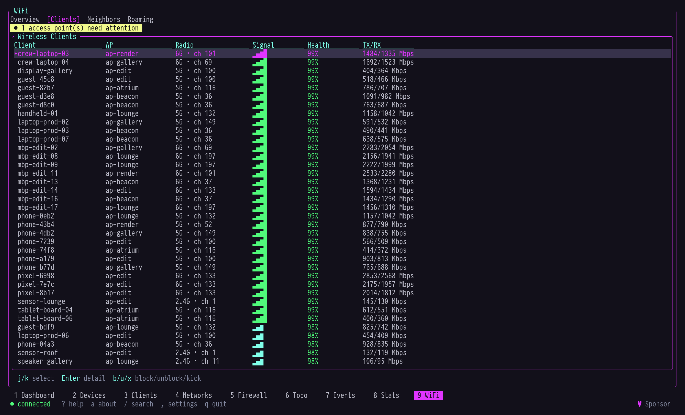
  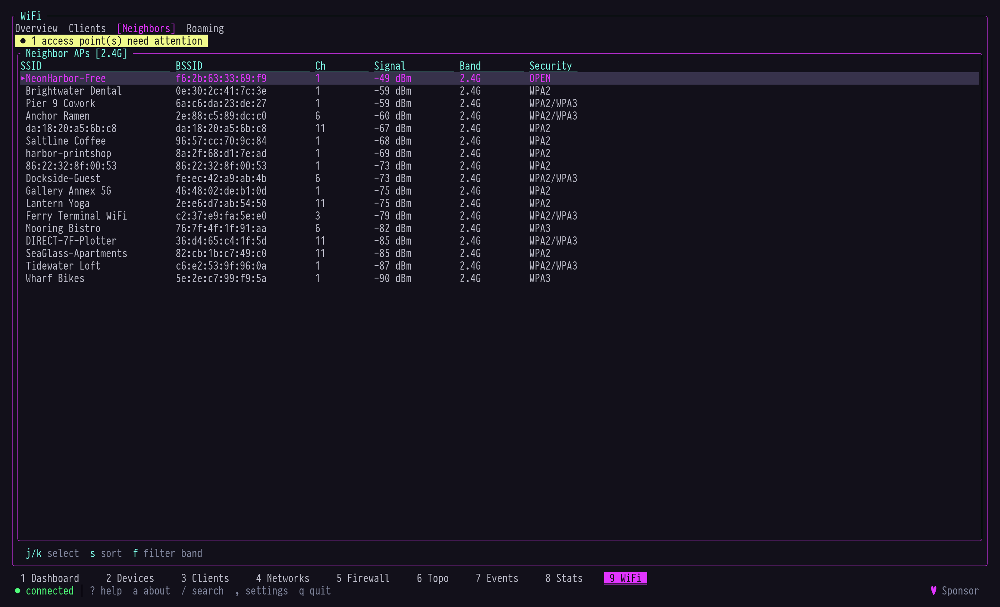
</p>

**Firewall and Topology**: policies grouped by zone pair in the order they apply, and the uplink tree from the gateway out

<p align="center">
  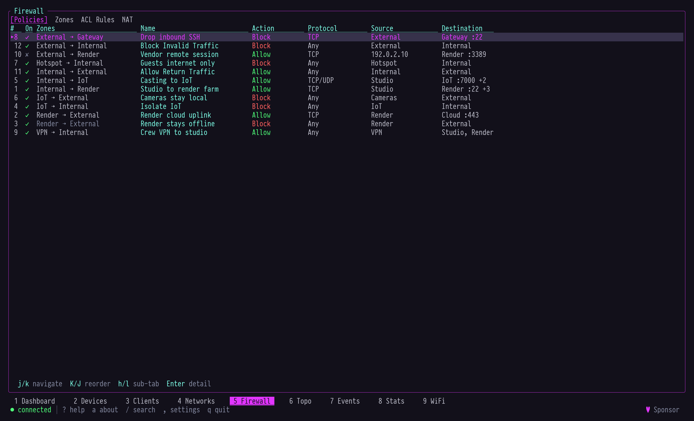
  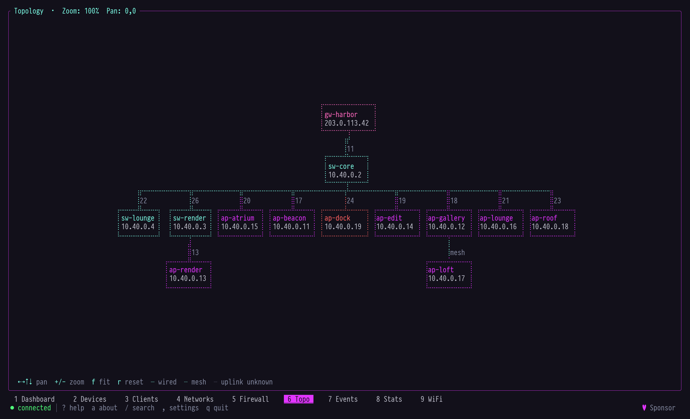
</p>

**Events**: the live stream with an events-by-hour heatmap

<p align="center">
  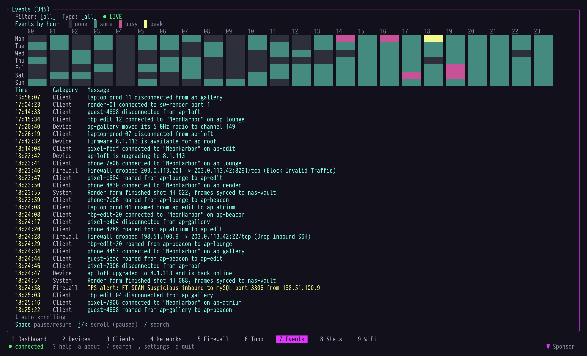
</p>

**Stats**: WAN bandwidth, client counts, and DPI over 1 hour, 24 hours, 7 days, and 30 days

<p align="center">
  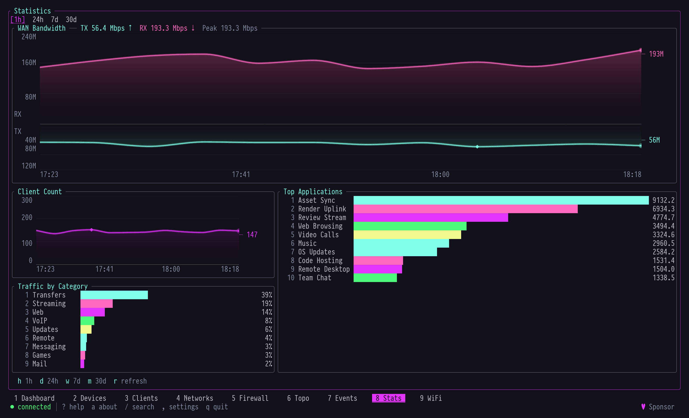
  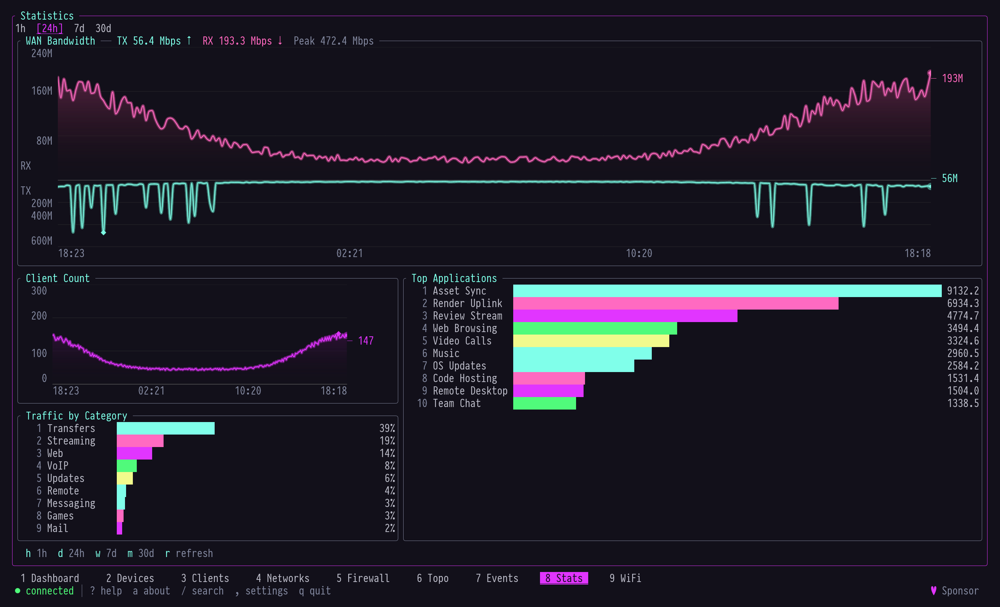
  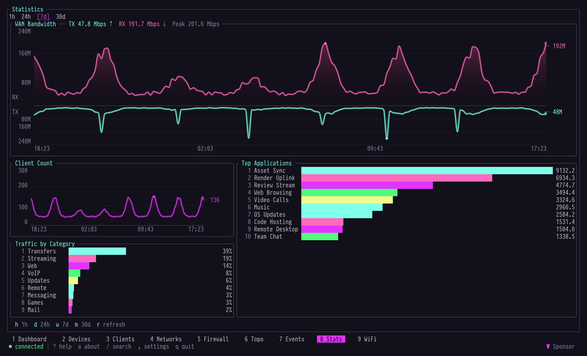
  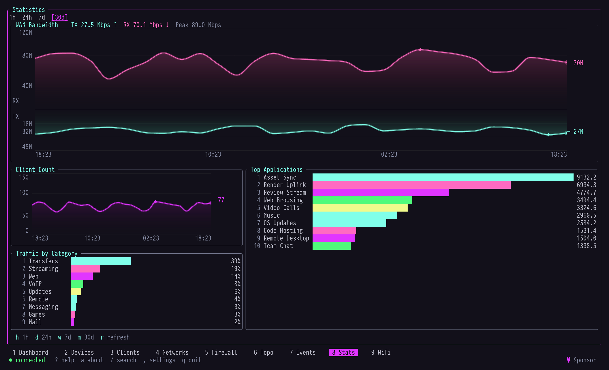
</p>

**Help overlay**: every keybinding at a glance

<p align="center">
  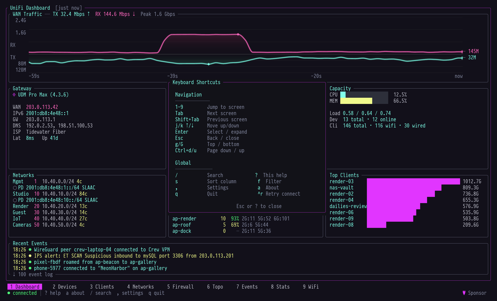
</p>

Full keybinding reference and screen details in the [TUI documentation](https://hyperb1iss.github.io/unifly/reference/tui).

---

## 🏗️ Architecture

Two crates, clean dependency chain:

| Crate          | Purpose                                                                                                                                                                          |
| -------------- | -------------------------------------------------------------------------------------------------------------------------------------------------------------------------------- |
| **unifly-api** | Async HTTP/WebSocket client, Controller lifecycle, reactive DataStore (`DashMap` + `tokio::watch`), entity models. Published on [crates.io](https://crates.io/crates/unifly-api) |
| **unifly**     | Single binary: CLI commands + `unifly tui` dashboard via feature flags, profile/keyring config, 11-screen ratatui dashboard with SilkCircuit theme                               |

Deep dive: [Architecture documentation](https://hyperb1iss.github.io/unifly/architecture/)

---

## ⚙️ Configuration

```bash
unifly config init             # Local controller setup wizard
unifly config cloud-setup      # Site Manager cloud setup wizard
unifly config profiles         # List profiles (* marks active)
unifly config use office       # Switch default profile
unifly -p home devices list    # One-off override
```

Named profiles for multiple controllers, OS keyring credential storage, environment variable overrides, and TOML config files. A `[defaults]` section supplies fallbacks for any profile that leaves a value unset:

```toml
# ~/.config/unifly/config.toml
[defaults]
insecure = false # accept self-signed certificates when true
timeout = 30     # request timeout in seconds
```

CLI flags and environment variables win over profile values, which win over `[defaults]`. Full details: [Configuration guide](https://hyperb1iss.github.io/unifly/guide/configuration)

---

## 📦 Library

[](https://crates.io/crates/unifly-api) · Async HTTP/WebSocket transport, high-level Controller, reactive DataStore, domain models

```rust
use unifly_api::{Controller, ControllerConfig, AuthCredentials, TlsVerification};
use secrecy::SecretString;

let config = ControllerConfig {
    url: "https://192.168.1.1".parse()?,
    auth: AuthCredentials::ApiKey(SecretString::from("your-api-key")),
    tls: TlsVerification::DangerAcceptInvalid,
    ..Default::default()
};
let controller = Controller::new(config);
controller.connect().await?;

let devices = controller.devices_snapshot();
println!("Found {} devices", devices.len());
```

Full API docs on [docs.rs/unifly-api](https://docs.rs/unifly-api). Usage guide with more examples: [Library documentation](https://hyperb1iss.github.io/unifly/reference/library)

---

## 🤖 AI Agent Skill

### Install Options

```bash
unifly skill --install                              # ~/.agents/skills, from the installed binary
unifly skill --install --claude                     # Claude Code's skills directory
npx skills add hyperb1iss/unifly                    # Claude Code, Cursor, Copilot, Codex, Gemini, ...
npx skills add hyperb1iss/unifly -a claude-code     # Target a specific agent
/plugin marketplace add hyperb1iss/unifly           # As a Claude Code plugin
```

`unifly skill --install` works offline, prints the installed path, and is safe to rerun. It upgrades a skill from `npx skills add` or an earlier release in place, and leaves any other `SKILL.md` alone unless you pass `--force`. Use `--dir <path>` for any other skills directory.

### What's Included

| Component                 | Description                                                                               |
| ------------------------- | ----------------------------------------------------------------------------------------- |
| **unifly skill**          | Complete CLI reference, command patterns, output formats, automation tips                 |
| **Network Manager agent** | Autonomous agent for provisioning, diagnostics, and security audits                       |
| **Runtime guide**         | `unifly skill core\|commands\|concepts\|workflows\|examples`, version-matched and offline |

---

## 💜 Sponsor unifly

unifly is indy open source. No VC, no telemetry, no upsells. Built by [@hyperb1iss](https://github.com/hyperb1iss) on real UniFi hardware, with help from a [growing list of contributors](https://github.com/hyperb1iss/unifly/graphs/contributors). Polished until the TUI sings.

If it saved you a trip to the web UI today, **sponsorship is what keeps the polish coming**: new screens, deeper API coverage, faster releases.

<p align="center">
  <a href="https://github.com/sponsors/hyperb1iss">
    
  </a>
</p>

---

## 🦋 Development

### Prerequisites

- Rust 1.94+ (edition 2024)
- A UniFi Network controller (Cloud Key, Dream Machine, or self-hosted)

### Build

```bash
git clone https://github.com/hyperb1iss/unifly.git
cd unifly
cargo build --workspace
```

### Test & Lint

```bash
cargo test --workspace
cargo clippy --workspace --all-targets
```

### Run

```bash
cargo run -p unifly -- devices list
cargo run -p unifly -- tui
```

### Workspace Layout

```
crates/
  unifly-api/      # Library: HTTP/WS transport, Controller, DataStore, domain models
  unifly/          # Single binary: CLI commands + tui subcommand, config, profiles
```

### Lint Policy

Pedantic clippy with `unsafe_code = "forbid"`. See `Cargo.toml` workspace lints for the full configuration. It's opinionated and we like it that way.

---

## ⚖️ License

Apache-2.0. See [LICENSE](LICENSE)

---

<p align="center">
  <a href="https://github.com/sponsors/hyperb1iss">
    
  </a>
  &nbsp;
  <a href="https://github.com/hyperb1iss/unifly">
    
  </a>
</p>

<p align="center">
  <sub>
    If unifly keeps your network running smooth, <a href="https://github.com/sponsors/hyperb1iss"><strong>sponsor the project</strong></a> or give it a ⭐
    <br><br>
    ✦ Built with obsession by <a href="https://hyperbliss.tech"><strong>Hyperbliss Technologies</strong></a> ✦
  </sub>
</p>
